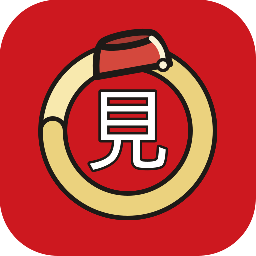

<div align="center">



# Mieruka 見える化

**See where every kilowatt-hour goes. Fix waste before the bill. Get rewarded for it.**

Built by team **Zero-Ichi** for **KIZUNA 2026** (ESPRIT · JICA · Tunisia–Japan), Smart Energy track.

[Live demo](https://kizuna-temp.vercel.app) · [Quick start](#quick-start) · [How it works](#how-it-works) · [Documentation](#documentation)

</div>

---

> [!NOTE]
> Mieruka is a hackathon prototype. Most data in the app is **simulated**, and it is labelled as simulated (`source: "simulee"`) on every screen where it appears. Bill figures are estimates, not invoices. Mieruka never touches mains power and cannot switch an appliance off.

## The problem

A Tunisian household gets one lump-sum electricity bill at the end of the month. It has no per-appliance breakdown and no warning that the air conditioner has been drawing 35% more than usual for three days. By the time the bill arrives it is too late to act. STEG, the national utility, has the same blind spot upstream: it sees load per building or region, not what drives the peak.

## The solution

Mieruka makes electricity **visible**, appliance by appliance:

- **Passive adapters.** Each adapter meters one appliance. It is identified by a QR code (`NABD-0003`) that carries only an ID and measures nothing. Because every tracked appliance has its own adapter, attribution is exact. There is no guessing which appliance a watt belongs to.
- **Explainable alerts.** A transparent rule engine flags waste with the evidence behind it: measured vs expected, the likely cause, a one-tap fix and a confidence score.
- **Fair rewards.** Verified kWh avoided becomes **Energy Tokens**, which households redeem for equipment or donate to solidarity projects.
- **Privacy-preserving grid view.** STEG gets an anonymous, aggregated picture. Households appear as pseudonyms (`FY-xxxx`), and areas with fewer than 10 households are masked.

## Features

| Role | What they get |
|---|---|
| **Household** (Foyer, Étudiant, Famille) | Live per-appliance watts, kWh today and this month, bill estimate on the real STEG tariff, monthly goal tracking, eco-score, 3D view of their installations, AI alerts and a weather-aware energy mission, a voice assistant, challenges, token rewards and a Learn section with quizzes and a bill simulator. |
| **Entreprise** | 30-day site kWh, CO₂, peak share, business equipment and TND contributions to solidarity projects. |
| **STEG** | Regional and building overview, meter equation, peak heatmap, incident list with resolve, anonymous household drill-down, and a map of simulated adapters on Tunisian building footprints. |

Highlights:

- **Explainable AI, not a black box.** Deterministic rules with evidence. See [the rules](#the-ai-rules).
- **Voice assistant (Gemini Live).** It follows the user's language in English, Japanese or Tunisian Arabic (Derja). It reads an allowlisted summary of the household's own data (devices, alerts, bill, tokens, forecast) and has no device-control tool. It needs explicit consent and a `GEMINI_API_KEY`.
- **Weather-aware forecast.** A 3-day forecast from [Open-Meteo](https://open-meteo.com/) with only broad regional coordinates sent. If the service is down, the app says so instead of pretending.
- **Interactive 3D room** of each household's adapters and appliances. Light pulses along the cord follow the live wattage.
- **Energy atlas.** About 1,000 simulated devices on real OpenStreetMap footprints across 9 Tunisian cities. Phones can pin a QR-scanned adapter using GPS.
- **Guided demo** with an 8-step coach-mark tour and a reset button, built for a live pitch.
- **Native Android client** (WebView) with LAN auto-discovery and CI-built APKs.
- **Smart Plug P1** digital twin: virtual ESP32 firmware, a 3D product twin and a signed plug → concentrator → STEG chain.

## How it works

```
 Adapters (simulated or real)                  Mieruka server (Django)                 Clients
┌──────────────────────────────┐        ┌───────────────────────────────────┐   ┌──────────────────────┐
│ m1/simulator (Node)          │ POST   │ m11  live feed, atlas, seed       │   │ React web app        │
│ p1-firmware (C++/ESP32 twin) ├───────►│ m12  data model                   │◄──┤ (frontend/ → assets/)│
│ phone + QR scan              │ /mesures│ m13  AI engine, voice, weather    │   ├──────────────────────┤
└──────────────────────────────┘        │ m14  household, rewards, tariff   │   │ Android WebView app  │
                                        │ m15  STEG aggregates, incidents   │   │ (mobile/)            │
                                        │ kizuna  auth, API gateway, learn  │   └──────────────────────┘
                                        └─────────────────┬─────────────────┘
                                                          │
                                       SQLite locally · Turso on Vercel
```

One server, one database. The measurement contract is frozen:

```json
POST /api/mesures
{"adaptateur_id": "NABD-0004", "horodatage": "2026-11-21T19:01:00.000Z", "watts": 917.3, "source": "simulee"}
```

Readings are deduplicated on `(adapter, timestamp)`, batches of up to 100 are accepted, and `X-Adapter-Key` is optional. The same contract accepts real hardware once a serial bridge is attached.

### The AI rules

Implemented in [m13/engine.py](m13/engine.py). Every alert carries its evidence.

| Rule | Trigger | Result |
|---|---|---|
| Overconsumption | 3 consecutive readings more than 35% above the appliance's own sliding median | Alert with cause, action, confidence and kWh/month avoided |
| Standby | Night average (01:00–06:00) above 5 W on an idle appliance | Switchable-power-strip recommendation |
| Simultaneous use | 2 or more appliances above 800 W and above 2.5 kW in total | "Shift the most flexible appliance" |
| Peak | Shiftable appliance above 0.3 kWh in an hour between 18:00 and 22:00 | "Run it after 22:00" |
| Daily threshold | Household total reaches 9 kWh in a day | One in-app alert per day, with optional eco mode (a simulation, never a command to a real appliance) |
| Goal | Monthly forecast more than 5% above the goal | Goal alert with the ratio |

**Why rules and not ML?** There is little training data, and every alert must be explainable to the user and defensible to a jury.

### Rewards

- **500 tokens per kWh avoided**, measured against the household's own reference, with a **daily cap of 400 tokens**.
- A zero balance never limits electricity. Tokens are rewards only.
- Eco-score 0–100: progress against your own baseline (40), standby share (25), actions taken (20), regularity (15).
- Bills use the **STEG residential low-voltage tariff** in force since 2022-05-01. CO₂ uses 0.468 kg/kWh.

### Privacy by design

- Simulated data is always labelled as simulated.
- The QR code is an identifier only. Location comes from an optional, consented phone GPS fix.
- STEG sees pseudonyms, never names, emails or addresses, and masks areas with fewer than 10 households.
- The Gemini API key never reaches the browser. Django mints a single-use, short-lived token.

## Quick start

### Prerequisites

| Tool | Version | Needed for |
|---|---|---|
| [uv](https://docs.astral.sh/uv/) | latest | Python env and running Django |
| Python | 3.14 (installed by uv) | Backend |
| Node.js | 22.13+ | Adapter simulator, frontend dev, pitch deck |

The built frontend is committed in `assets/app/`, so **you don't need Node to run the web app**.

### Run the app

```powershell
# 1. Install dependencies
uv sync

# 2. Create the database and the demo dataset
uv run manage.py migrate
uv run manage.py mieruka_reset

# 3. Start the server
uv run manage.py runserver
```

Open **http://127.0.0.1:8000** and sign in as a demo household. One-click demo access works for Foyer, Étudiant, Famille and Entreprise. To sign in as STEG, use Email sign-in with the password set in `MIERUKA_STEG_PASSWORD`.

Demo accounts use the password `mieruka2026` (except STEG). With `MIERUKA_DEMO_LOCAL_ONLY=true`, demo accounts only answer requests from the local machine.

### Add live readings (optional)

In a second terminal, start the virtual adapters:

```sh
node m1/simulator/server.mjs
```

Then open **http://127.0.0.1:8787** for the atlas of simulated devices. The simulator sends five demo readings every two seconds to Django's `/mesures`, queues undelivered readings on disk and replays them. Switch fault scenarios at any time:

```sh
curl -X POST http://127.0.0.1:8787/scenario -H "Content-Type: application/json" -d '{"mode":"spike"}'   # one AC spike
curl -X POST http://127.0.0.1:8787/scenario -H "Content-Type: application/json" -d '{"mode":"drift"}'   # sustained high load
curl -X POST http://127.0.0.1:8787/scenario -H "Content-Type: application/json" -d '{"mode":"normal"}'  # recover
```

The full adapter API, pairing flow and delivery contract are in [DEV.md](DEV.md#headless-adapter-api).

### Configuration

Copy [.env.example](.env.example) to `.env.local` (git-ignored). Everything is optional for local development.

| Variable | Purpose |
|---|---|
| `GEMINI_API_KEY` | Enables the voice assistant. Without it the page shows an error rather than faking replies. |
| `GEMINI_LIVE_MODEL` | Gemini Live model name |
| `TURSO_DATABASE_URL`, `TURSO_AUTH_TOKEN` | Use a remote Turso database instead of local `db.sqlite3`. Check which database you point at before running `migrate`. |
| `DJANGO_SECRET_KEY` | Required on Vercel |
| `MIERUKA_STEG_PASSWORD` | Password for the STEG demo account. Unset means STEG demo sign-in is disabled. |
| `MIERUKA_STAFF_EMAILS` | Google emails granted back-office access |
| `GOOGLE_CLIENT_ID`, `GOOGLE_CLIENT_SECRET` | Google sign-in through django-allauth |
| `MIERUKA_DEMO_LOCAL_ONLY` | Restrict demo accounts and controls to the local machine |
| `MIERUKA_ADAPTER_KEY` | Optional key required on adapter requests |

Never commit real tokens. See [DEV.md](DEV.md) for Vercel, Turso and Blob storage setup.

### Develop the frontend

```powershell
cd frontend
npm install
npm run dev      # Vite on :5173, proxies /api to Django on :8000
npm run build    # type-checks, then builds into ../assets/app
```

Commit the rebuilt `assets/app/` when you change the frontend, because Django serves it directly.

### Test

```powershell
uv run manage.py check
uv run manage.py test            # everything
uv run manage.py test m13        # one app
node --test m1/simulator/*.test.mjs   # simulator unit tests
```

## Tech stack

| Layer | Technology |
|---|---|
| Backend | Django 5.2, Python 3.14, django-allauth (Google sign-in), uv |
| Database | SQLite locally, Turso (libSQL over HTTP) on Vercel, Vercel Blob for private uploads |
| Frontend | React 19, TypeScript, Vite 6, Tailwind CSS 4, Radix UI, TanStack Query, React Router 7, Recharts, motion |
| 3D and maps | three.js with react-three-fiber, d3-geo and Leaflet with OpenStreetMap |
| AI | Rule engine in Python, Gemini Live for voice, Open-Meteo for weather |
| Simulator | Node.js 22 (built-in HTTP, fetch and SQLite), Server-Sent Events |
| Mobile | Kotlin Android WebView app, GitHub Actions APK builds |
| Hardware twin | C++ firmware, ESP32 on Wokwi, MQTT, Three.js |
| Hosting | Vercel (Django) |

## Project structure

```
KIZUNA/
├── config/            Django settings, URL routing, Turso DB backend, blob storage
├── kizuna/            Core app: auth, API gateway, learn and bill simulator, terms, SPA shell
├── m11/               Live feed, simulator model, atlas, demo seed and reset commands
├── m12/               Data model and aggregation helpers
├── m13/               AI engine, alerts, Gemini Live token, Open-Meteo weather
├── m14/               Household space, tariff, rewards, solidarity, company view
├── m15/               STEG aggregates, buildings, incidents, receiver
├── m1/ … m5/, m10/    Original hackathon module apps: simulator lab, back office, Google login
├── frontend/          React app (src/), 3D experience, pitch deck (presentation/)
├── assets/            Branding, atlas data, and the built frontend (assets/app/)
├── m1/simulator/      Node adapter simulator and Tunisian atlas
├── mobile/            Native Android client
├── p1-firmware/       Smart Plug P1 firmware, concentrator and STEG server kit
├── IOT/               Smart Plug digital twin (virtual ESP32 plus 3D page over MQTT)
├── k-mod/             Module specifications and the Arduino demo sketch
└── templates/         Django templates for the SPA shell and back office
```

### Web app routes

| Path | Who | What |
|---|---|---|
| `/`, `/login` | Everyone | Landing page and sign-in |
| `/app/accueil` | Households | Dashboard: live power, 3D room, bill estimate, alerts |
| `/app/appareils` | Households | Devices, QR pairing, per-device history |
| `/app/analyse` | Households | AI analysis, mission, forecast, voice assistant |
| `/app/recompenses` | Households | Eco-score, challenges, tokens, catalogue, donations |
| `/app/apprendre` | Households | Quizzes, vampire hunt game, bill simulator |
| `/app/explorer`, `/app/flux`, `/app/comparer` | Households | Explore, energy flows, compare |
| `/app/entreprise` | Entreprise | Site-level view |
| `/app/steg/*` | STEG | Network, buildings, households, incidents, peak, registrations |
| `/api/…` | Clients | JSON API, routes in [config/api_urls.py](config/api_urls.py) |
| `/m5/` | Staff | Django back office |

## Other components

### Android app

The `mobile/` folder is a Kotlin Android Studio project that wraps the web app. On a trusted network, run `.\run-kizuna.ps1` and the phone discovers the server over mDNS with no URL to type. CI builds a signed APK on every push to `master` and publishes it as a GitHub Release. See [mobile/DEV.md](mobile/DEV.md) and [DEV.md](DEV.md#android-testing-and-deployment).

### Smart Plug P1 and IoT twin

[p1-firmware/p1-firmware/](p1-firmware/p1-firmware/README.md) runs the plug firmware as native C++ or on Wokwi. It sends signed frames through a concentrator to a STEG server, and can forward readings to the cloud app. [IOT/](IOT/README.md) is a virtual ESP32 with a 3D digital twin over MQTT. Both include scripted demos.

### Pitch deck

`frontend/presentation/mieruka-pitch.html` is the five-minute jury deck, a single offline file. Press `F` for full screen and `P` for the presenter view. See [the presenter guide](frontend/presentation/PRESENTER-GUIDE.md).

## Documentation

| Document | Contents |
|---|---|
| [DEV.md](DEV.md) | Developer guide: setup, adapter API, pairing, Google login, Vercel, Turso, Android CI |
| [JURY_PACKAGE.md](JURY_PACKAGE.md) | Story, user stories and theory for the jury |
| [k-mod/mieruka-00-index.md](k-mod/mieruka-00-index.md) | Module map and scope rules |
| [KIZUNA_FULL_PROJECT_AUDIT.md](KIZUNA_FULL_PROJECT_AUDIT.md) | Full project audit |
| [MIERUKA_3D_EXPERIENCE_TECHNICAL_AUDIT.md](MIERUKA_3D_EXPERIENCE_TECHNICAL_AUDIT.md) | 3D experience technical audit |
| [frontend/src/experience3d/README.md](frontend/src/experience3d/README.md) | 3D room architecture |

## Contributing

`master` is the integration branch. Work on your module branch, open a pull request to `master`, and run `uv run manage.py check` and the relevant tests first. Stage only the files related to your change. Commit migrations with the model changes that generated them, and never edit a migration that has already been shared. Details are in [DEV.md](DEV.md#repository-workflow).

## Branding

The Mieruka app icon is [assets/mieruka/mieruka-app-icon-v8-rounded.svg](assets/mieruka/mieruka-app-icon-v8-rounded.svg), and the Zero-Ichi fox logo is [assets/mieruka/zero-itchi-fun-logo.svg](assets/mieruka/zero-itchi-fun-logo.svg) (an [animated version](assets/mieruka/zero-itchi-fun-logo-animated.svg) is also available).

---

<div align="center">

**Mieruka** (見える化): *making the invisible visible.*
Team Zero-Ichi · KIZUNA 2026

</div>
