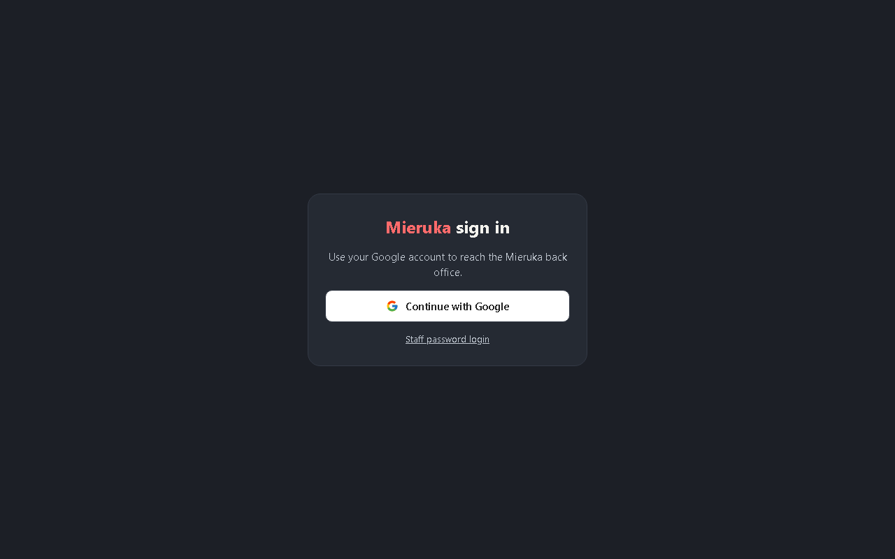

# Module 10 — User management

**Owner:** to assign · **Django app:** `m10` · **Branch:** `m10`
**Dependencies:** M2 (`utilisateurs` table) · **Used by:** M4 (household screens), M5 (back office access)
**Plan:** Sprint 1 — sign in with Google (done) · Sprint 2 — link accounts to households, staff role for the back office · Sprint 3 — profile editing, account deletion

## Features

- Sign in with Google through django-allauth (decided 2026-11-21; Clerk and a FastAPI service were the alternatives).
- Staff: Google accounts whose verified email is in `MIERUKA_STAFF_EMAILS` become staff and can open the M5 back office.
- One login account per household: `Utilisateur.compte` (M2) links the account to its household profile.
- Roles: household (M4 screens) and staff (M5 back office).

## Data and rules

| Rule | Requirement |
|---|---|
| Accounts | A Google account maps to one Django user, linked to one household. |
| Staff | Only staff accounts open the M5 back office. |
| Privacy | A household only ever sees its own data. |
| Deletion | Deleting an account unlinks the household; anonymous aggregates stay. |
| Secrets | `GOOGLE_CLIENT_ID` and `GOOGLE_CLIENT_SECRET` live in environment variables, never in the repo. |
| Sign-up | Only Google creates accounts; there is no email/password sign-up. |

## Pages

`app_name = "m10"`:

| URL | Purpose |
|---|---|
| `/m10/` | Sign-in page: Google button, account status, back-office link |
| `/accounts/google/login/` | Starts Google sign-in (POST) |
| `/accounts/google/login/callback/` | Google's redirect target; register it in the Google OAuth client |
| `/accounts/logout/` | Sign out (POST) |

## Stories

| ID | Outcome | Priority |
|---|---|---|
| 10.1 | A user signs in with Google | Must |
| 10.2 | A signed-in user is linked to their household | Must |
| 10.3 | Staff accounts reach the back office; others cannot | Must |

## Screenshot

