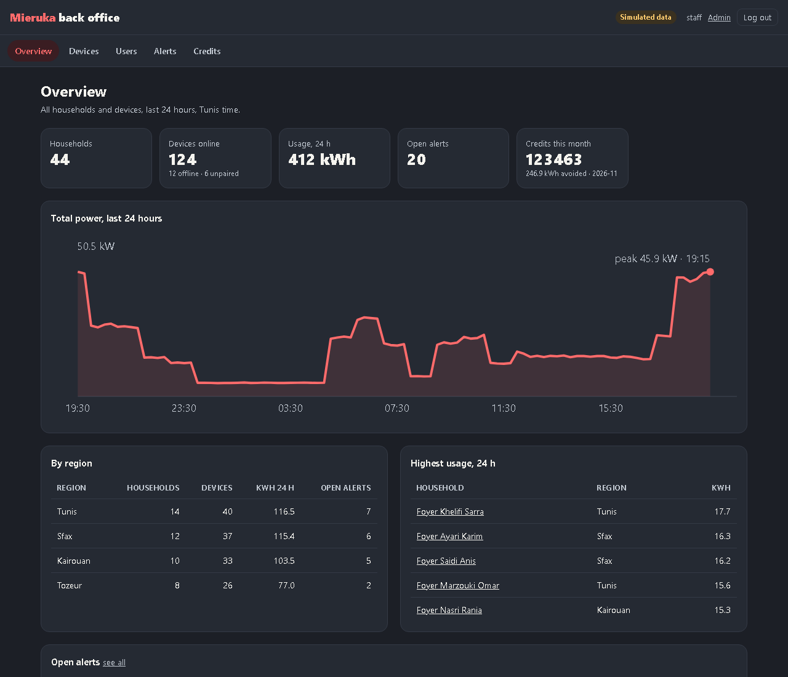

# Module 5 — Back office

**Owner:** Member 4 (confirm) · **Django app:** `m5` · **Branch:** `m5`
**Dependencies:** M2 (data model), M3 (alerts), M4 (rewards formula), M10 (login, later) · **Used by:** the Mieruka team and STEG staff
**Plan:** Sprint 1 — monitoring pages (done) · Sprint 2 — actions (resolve alert, pair/unpair adapter, adjust credits) · Sprint 3 — STEG aggregate tab, exports

Source: [k-mod/mieruka-07-steg-space.md](../k-mod/mieruka-07-steg-space.md) for the STEG view, which becomes one tab of the back office. M5 is reserved for the back office; user accounts and Google sign-in live in [M10](../m10/mieruka-m10-user-management.md).

## Features

- Staff-only administration of the whole Mieruka deployment: every device, every household, usage, alerts and credits.
- Overview: households, devices online/offline/unpaired, kWh in the last 24 hours, open alerts, credits this month, a 24-hour power chart, usage by region and the highest-usage households.
- Devices: every `MIERUKA-xxxx` adapter with status, household, appliance, current power, kWh over 24 hours, last reading and open alerts; search and filter by status and region.
- Users: every household with region, size, home type, devices, kWh, credits, open alerts and account link; search, filter and sort.
- User detail: one household's devices, power chart, alerts and monthly credits.
- Alerts: open, resolved or all, with the M3 explanation sent to the household.
- Credits: points and kWh avoided per month, and a ranked ledger for each month.

## Data and rules

| Rule | Requirement |
|---|---|
| Access | Staff only (`is_staff`). Django admin accounts until M10 adds Google sign-in. |
| Time | Stored in UTC, shown in Tunis local time (UTC+1). |
| Usage | kWh per adapter = average power × the time span its readings cover. |
| Credits | points = floor(kWh avoided × 500); nothing is ever subtracted. |
| Label | Every page shows "Simulated data" while the data comes from the simulator. |
| STEG tab | When added, it shows aggregates only and hides regions with fewer than 10 households. |
| Essential power | The back office has no action that cuts anyone's power. |

## Pages

`app_name = "m5"`:

| URL | Purpose |
|---|---|
| `/m5/` | Overview |
| `/m5/devices/` | All adapters (`?q=`, `?status=`, `?region=`) |
| `/m5/users/` | All households (`?q=`, `?region=`, `?sort=kwh|points|alerts|name`) |
| `/m5/users/<id>/` | One household |
| `/m5/alerts/` | Alerts (`?state=open|resolved|all`) |
| `/m5/credits/` | Credits by month (`?period=AAAA-MM`) |

## Stories

| ID | Outcome | Priority |
|---|---|---|
| 5.1 | Staff see every device with its status and current usage | Must |
| 5.2 | Staff see every household's usage, credits and alerts | Must |
| 5.3 | Non-staff visitors cannot open any back-office page | Must |
| 5.4 | Staff resolve an alert or re-pair an adapter from the back office | Should |
| 5.5 | STEG tab with regional aggregates and the 10-household minimum | Should |

## Integration and checks

- Reads the M2 tables directly (`m2.models`). Demo data: `uv run manage.py seed_demo --reset`.
- `m5/tests.py`: anonymous and non-staff users are redirected; every page renders for staff; filters work; the kWh calculation matches a hand-worked example.

## Screenshot

